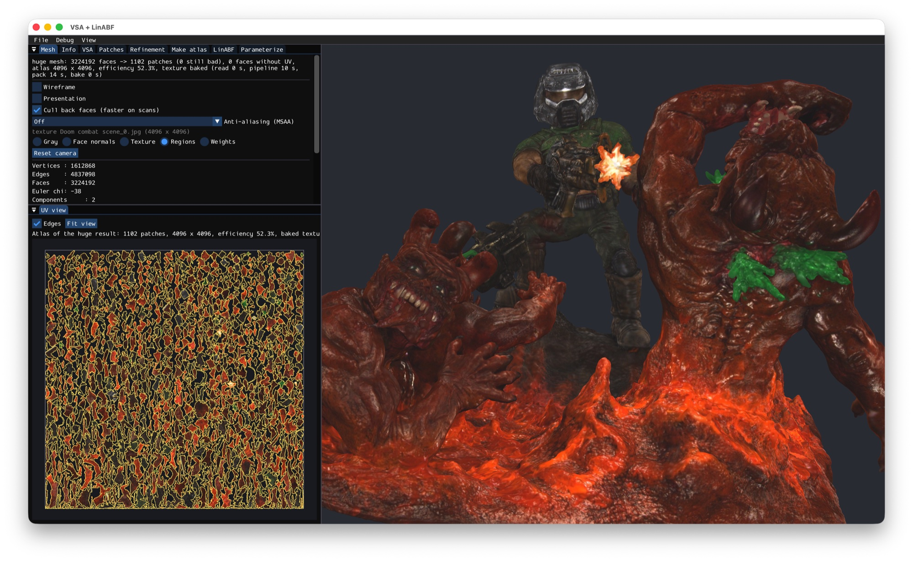

# huge-atlas

Unwrap 100 million triangles seamlessly—with the market's only tool built for massive meshes.



*The Doom combat scene scan (3.2M faces, [Artec 3D](https://www.artec3d.com), CC BY 3.0) in huge mode, unwrapped in 24 seconds (10 s segmentation and unfolding, 14 s packing): 1102 patches, a 4096 x 4096 atlas with the texture baked into it.*

A macOS tool (C++17, OpenGL 4.1 Core, Dear ImGui) that segments a triangle mesh into patches with
**Variational Shape Approximation** (Cohen-Steiner, Alliez, Desbrun, SIGGRAPH 2004), unwraps every patch with
**Linear Angle Based Parameterization** (Zayer, Lévy, Seidel, SGP 2007), packs the charts into one UV atlas that is safe
for mip mapping (Horizon pack, Lévy et al. 2002) and bakes the texture of the source mesh into the new atlas.

## Install (no programming needed)

1. Download `huge-atlas-<version>-arm64.dmg` from the [Releases](https://github.com/vladimir-vasilyev/huge-atlas/releases) page
   (Apple Silicon Macs, macOS 11 or newer).
2. Open the disk image and drag **huge-atlas** to **Applications** (do not run it from the disk image: it is read-only, and the next step needs the copy).
3. Open **huge-atlas** from Applications. Since 0.2.1 the app is signed with a Developer ID and notarized by Apple: macOS asks only
   the usual *"downloaded from the Internet, open it?"* once. (The older 0.1.0 and 0.2.0 are not notarized and are blocked with *"Apple could
   not verify…"*; if you have one of them, copy it to Applications and run `xattr -dr com.apple.quarantine /Applications/huge-atlas.app`,
   or on macOS 15 and newer press **Open Anyway** in System Settings > Privacy & Security.)
4. Open a mesh (OBJ or PLY, **File > Open**), press **Make atlas** (or **Make atlas (huge)** for scans of millions of faces) and save
   the result with **File > Save**: OBJ or PLY with the new UV and a texture baked into the new atlas.

The window **Atlas** walks through the steps: 1. open a mesh (or drop the file on the window), 2. choose the quality (Fast / Balanced / Detailed),
optionally the number of patches, the texture size and the mip levels, 3. **Make atlas**: the regular or the huge pipeline is chosen by itself
by the size of the mesh (above 3 million faces, or a file of more than 300 MB, it is the huge mode), 4. look at the result (patches,
presentation, texture, UV checker) and **Save**. **More** has the repacking of the atlas with another texture size and mip levels and
the comparison with the original layout. Everything else (partition, patches, unfolding steps, the debug menu) is in **View > Developer mode**.

The settings of the windows are kept in `~/Library/Application Support/huge-atlas`; files that the Debug menu writes go to
`~/Documents/huge-atlas/DebugOut`.

To make the disk image yourself: `./scripts/make_dmg.sh` (builds, makes `dist/huge-atlas.app` and the `.dmg`; with `CODESIGN_IDENTITY` and `NOTARY_PROFILE` it signs with a Developer ID and notarizes, see the header of the script).

## Two modes

- **Make atlas** — the mesh is loaded as a half-edge mesh (OpenMesh); VSA, patch extraction, repair ladder
  (LinABF → active set → slits → LSCM → Tutte), automatic splitting of patches that do not unfold, packing, texture baking.
- **Make atlas (huge)** — for dense scans (tens of millions of faces) on flat arrays (about 100 bytes per face): the mesh is
  simplified (meshoptimizer, parallel), segmented and unwrapped on the simplified copy, the charts are lifted back onto the
  full mesh, patches that do not lift are repaired or re-unwrapped, the atlas is packed and the texture moved to it.
  The size of the simplified copy is a percentage of the faces (10% = 10 times fewer).

Both modes compare the result with the UV layout stored in the file (distortion, seams, texel density, gaps between charts,
mip levels the layout can use) and save OBJ / PLY with the atlas UV and the baked texture.

## Requirements

- macOS, Xcode (or Command Line Tools)
- CMake ≥ 3.20 (`brew install cmake`)

## Build

```bash
git clone --recurse-submodules https://github.com/vladimir-vasilyev/huge-atlas.git
cd huge-atlas
# if the clone has no submodules: ./scripts/setup_deps.sh
cmake -G Xcode -B build-xcode
cmake --build build-xcode --config Release --target vsa_app
./build-xcode/Release/vsa_app
```

Without Xcode: `cmake -B build -DCMAKE_BUILD_TYPE=Release && cmake --build build -j`.
Tests (their own group in the IDE project): `cmake --build build-xcode --config Release --target all_tests`, then `ctest`.
Use a Release build for big models: a Debug build is very slow on large meshes.

## Models

Large test models are not part of the repository. `data/` has only small ones (a Stanford bunny, a cube, a hemisphere).
The scenes used for the measurements (a 3.2M face scan of a combat scene and a 5.7M face car, both by
[Artec 3D](https://www.artec3d.com), CC BY 3.0) have to be downloaded separately and put in `data/doom-combat-scene_obj/`
and `data/car/`; `data/*/license.txt` keep their attribution.

## Testing without clicks

Environment hooks run the pipeline and exit, for example:

```bash
VSA_AUTO_ATLAS=1 VSA_MESH=data/bunny.ply VSA_K=8 ./build-xcode/Release/vsa_app
VSA_AUTO_HUGE=data/car/FIN_CAR_D.obj VSA_K=200 VSA_HUGE_PERCENT=10 VSA_ATLAS_RES=8192 VSA_ATLAS_MIP=1 VSA_AUTO_BAKE=1 ./build-xcode/Release/vsa_app
```

The hooks are read in `src/app/App.cpp` (search for `getenv("VSA_`); the plan is in `docs/PLAN.md`.

## Layout

```
external/      dependencies (git submodules)
scripts/       helper scripts
src/app/       window, main loop, UI
src/render/    OpenGL wrappers, shaders, drawing
src/core/      mesh, VSA (no GL / ImGui dependency)
src/param/     patches, LinABF, UV, repair, huge pipeline, atlas packing
tests/         tests of the core
```

## References

- Cohen-Steiner, Alliez, Desbrun. *Variational Shape Approximation.* SIGGRAPH 2004.
- Zayer, Lévy, Seidel. *Linear Angle Based Parameterization.* SGP 2007.
- Sheffer, Lévy, Mogilnitsky, Bogomyakov. *ABF++: Fast and Robust Angle Based Flattening.* ACM TOG 2005.
- Lévy, Petitjean, Ray, Maillot. *Least Squares Conformal Maps for Automatic Texture Atlas Generation.* SIGGRAPH 2002.

## License

MIT, see `LICENSE`. The dependencies in `external/` have their own licenses.
